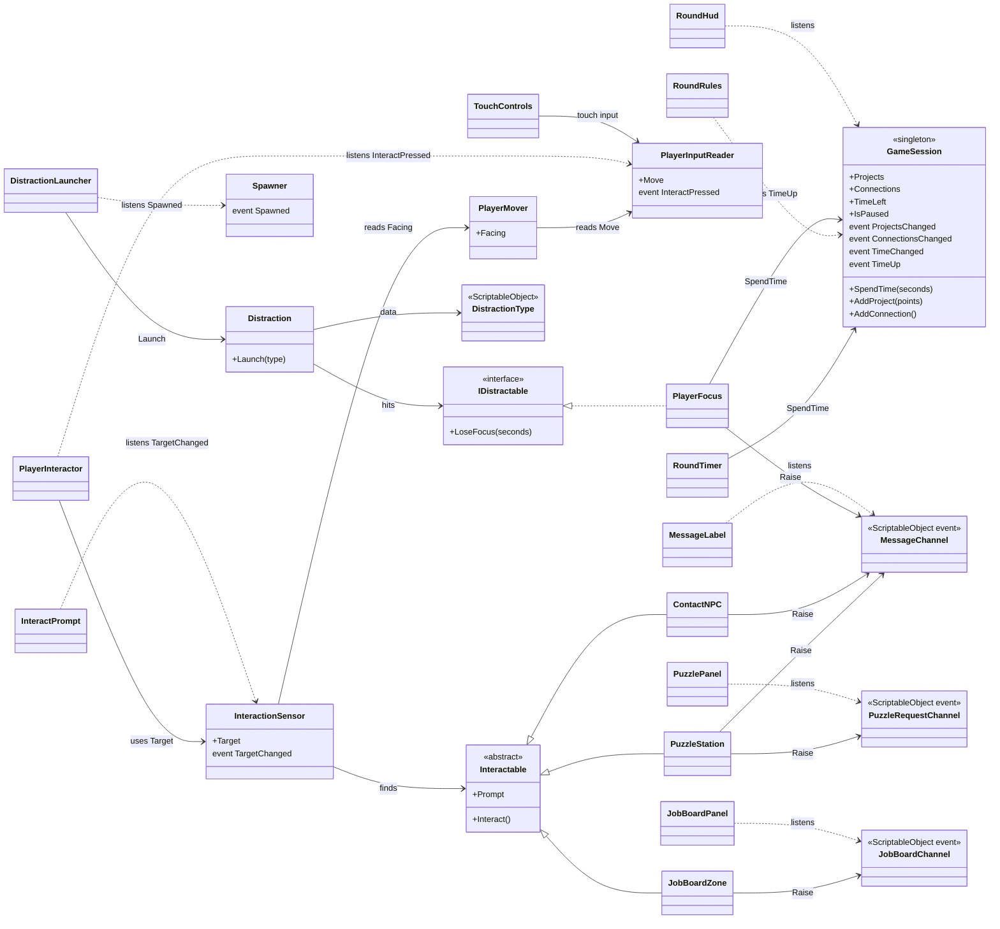
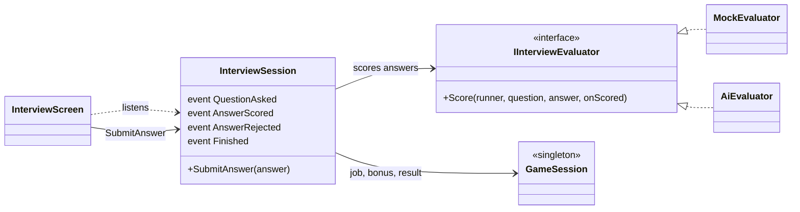

# 🎮 הראיון הבא (The Next Interview)

> *כל משרה מתחילה בפרויקט אחד. הראיון הוא המקום שבו מוכיחים אותו.*

משחק דו-ממדי ב-Unity על חיפוש עבודה. השחקן מסתובב בעיר, פותר חידות כדי לצבור פרויקטים, יוצר קשרים עם אנשים, מתחמק מהסחות דעת, ואז מתראיין למשרה.

**קישורים**

- שחקו בדפדפן (itch.io): https://adisagi.itch.io/thenextinterview
- סרטון משחק במובייל: https://youtu.be/IqiK_WastL4
- תכנון המשחק (רכיבים רשמיים, מחקר שוק ותכנון שלבים): https://github.com/SagiAdi/The-Next-Interview
- רכיבים דרמטיים (מטלה 5): [dramatic-elements.md](dramatic-elements.md)
- סיפור ה-Twine, לשחק בדפדפן: https://sagiadi.github.io/The-Next-Interview-Game/story/the-next-interview.html (קובץ ה-HTML: [story/the-next-interview.html](story/the-next-interview.html))

**צוות:** שגיא רהט, עדי פלצקי.

---

## איך משחקים

1. **פרויקטים:** בחדר החידות (מימין) עומדים מול חידה ולוחצים E. תשובה נכונה מוסיפה נקודות פרויקט (חידה קשה נותנת יותר).
2. **קשרים:** עומדים מול אדם בעיר ולוחצים E. כל קשר פעיל 90 שניות ונותן בונוס של 5 נקודות בראיון (עד 15).
3. **הסחות דעת:** הכדורים האדומים והסגולים קופצים בעיר. כל פגיעה מורידה זמן מהשעון, ופגיעה חזקה מורידה יותר.
4. **לוח המשרות:** כשיש מספיק פרויקטים, עומדים מול הלוח הכחול, לוחצים E ובוחרים משרה.
5. **הראיון:** עונים על שלוש שאלות. הציון הסופי הוא ממוצע התשובות ועוד בונוס הקשרים.

| משרה | פרויקטים נדרשים | ציון נדרש |
|---|---|---|
| Junior Developer | 1 | 60 |
| Senior Game Developer | 4 | 80 |
| Lead Designer | 6 | 90 |

**ניצחון:** התקבלתם למשרה. **הפסד:** חמש הדקות נגמרו לפני שהתקבלתם.

| פעולה | מחשב | טלפון |
|---|---|---|
| תזוזה | חצים או WASD | ג'ויסטיק בפינה השמאלית התחתונה |
| אינטראקציה | E או רווח | כפתור Interact בפינה הימנית התחתונה |

---

## איך מריצים

1. מתקינים Unity `6000.6.7f1` (עם מודול Web).
2. משכפלים את הריפו ופותחים את התיקייה ב-Unity Hub (Add ← Add project from disk).
3. פותחים את הסצנה `Assets/Scenes/Menu.unity` ולוחצים Play.

הסצנות, הפריפאבים וקובצי הנתונים נוצרים על ידי הכלי **Tools ← Next Interview ← Create Everything**. הם כבר נמצאים בריפו, ואפשר להריץ את הכלי שוב כדי לבנות אותם מחדש.

לבניית גרסת הדפדפן: **Tools ← Next Interview ← Build WebGL**. התוצאה נשמרת בתיקייה `Builds/WebGL`.

---

## פיסיקה במשחק (מטלה 4, חלק א)

| תכונה | איפה בקוד | מה היא עושה במשחק |
|---|---|---|
| גוף קשיח `Rigidbody2D` | `Player/PlayerMover.cs`, `Obstacles/Distraction.cs` | השחקן וההסחות הם גופים דינמיים, והקירות עוצרים אותם בהתנגשות רגילה |
| כוחות `AddForce`, `AddTorque` | `PlayerMover.FixedUpdate`, `Distraction.Launch` | השחקן נדחף אל המהירות המבוקשת (F = m·a). ההסחה מקבלת דחיפה וסיבוב בשיגור |
| הטלת קרניים `CircleCast`, `Raycast` | `Player/InteractionSensor.cs` | עיגול מוטל קדימה מהשחקן כדי למצוא עם מה אפשר לתקשר, וקרן בודקת שאין קיר באמצע |
| התנגשות `Collision2D` | `Distraction.OnCollisionEnter2D` | הזמן שמאבדים תלוי ב-`relativeVelocity`, וההסחה נהדפת מנקודת המגע (`GetContact`) |
| חומר פיסיקלי `PhysicsMaterial2D` | `Assets/Data/Physics/Bouncy` | ההסחות קופצות מהקירות בלי לאבד מהירות |

בקר דמות קינמטי (`CharacterController`) ממומש במשחק השני שלנו, [Life Capital](https://github.com/SagiAdi/Life-Capital).

---

## ארכיטקטורה (מטלה 4, חלק ב)

### מבנה התיקיות

```
Assets/
├── Scripts/
│   ├── Player/      PlayerInputReader, PlayerMover, InteractionSensor, PlayerInteractor, PlayerFocus
│   ├── World/       Interactable, PuzzleStation, ContactNPC, JobBoardZone, Spawner
│   ├── Obstacles/   Distraction, DistractionLauncher, IDistractable
│   ├── Game/        GameSession, RoundTimer, RoundRules, Scenes
│   ├── Interview/   InterviewSession, InterviewResult, IInterviewEvaluator, MockEvaluator, AiEvaluator
│   ├── Puzzle/      PuzzleGenerator
│   ├── UI/          RoundHud, MessageLabel, InteractPrompt, TouchControls, VirtualJoystick,
│   │                PuzzlePanel, JobBoardPanel, InterviewScreen, MenuScreen, EndScreen, UIBuilder
│   ├── Events/      EventChannel, MessageChannel, PuzzleRequestChannel, JobBoardChannel
│   ├── Data/        GameSettings, JobOffer, DistractionType  (מחלקות ScriptableObject)
│   ├── Animation/   SpriteAnimator, VelocityAnimationDriver
│   └── Utils/       Placeholder, PlaceholderArt
├── Data/            קובצי הנתונים: Jobs, Distractions, Events, Physics
├── Resources/       GameSettings.asset
├── Prefabs/         PuzzleStation, ContactNPC (x3), Distraction
├── Scenes/          Menu, City, Interview, Win, GameOver
├── Art/             דמויות
└── Editor/          SetupWizard, WebBuild
```

### יחסי המחלקות

קוד המשחק (שחקן, עולם, מכשולים, חוקים) לא מכיר את קוד הממשק. הממשק מאזין לאירועים, וכל הרשמה ב-`OnEnable` מבוטלת ב-`OnDisable`.



חץ מלא פירושו קריאה ישירה. חץ מקווקו פירושו האזנה לאירוע.

סצנת הראיון בנויה באותה צורה: החוקים ב-`InterviewSession`, והמסך מאזין לו.



### האירועים: מי שולח ומי מקבל

| אירוע | סוג | מי שולח | מי מאזין |
|---|---|---|---|
| `TimeChanged`, `ProjectsChanged`, `ConnectionsChanged` | `event` של C# | `GameSession` | `RoundHud` |
| `TimeUp` | `event` של C# | `GameSession` | `RoundRules` (טוען את מסך ההפסד) |
| `InteractPressed` | `event` של C# | `PlayerInputReader` | `PlayerInteractor` |
| `TargetChanged` | `event` של C# | `InteractionSensor` | `InteractPrompt` |
| `Spawned` | `event` של C# | `Spawner` | `DistractionLauncher` |
| `DirectionChanged` | `event` של C# | `VirtualJoystick` | `TouchControls` |
| `QuestionAsked`, `AnswerScored`, `AnswerRejected`, `Finished` | `event` של C# | `InterviewSession` | `InterviewScreen` |
| `Messages` | ערוץ ScriptableObject | `PuzzleStation`, `ContactNPC`, `PlayerFocus` | `MessageLabel` |
| `PuzzleRequests` | ערוץ ScriptableObject | `PuzzleStation` | `PuzzlePanel` |
| `JobBoardOpened` | ערוץ ScriptableObject | `JobBoardZone` | `JobBoardPanel` |

### שלוש החלטות ארכיטקטורה

**1. ערוצי אירועים (ScriptableObject) בין העולם לממשק, במקום קריאה ישירה.**
בגרסה הקודמת חידה קראה ישירות ל-`PuzzlePanel.Get().Open(...)` ול-`HUD.Say(...)`, כך שקוד המשחק הכיר את הממשק ונשען על משתנים סטטיים. עכשיו החידה מרימה אירוע על ערוץ, והפאנל מאזין לו. החלופה הייתה להשאיר הפניה ישירה. בחרנו בערוץ כי אפשר להחליף או למחוק את הפאנל בלי לגעת בקוד המשחק, וכי פריפאב שנוצר בזמן ריצה לא צריך לחפש אובייקט בסצנה.

**2. פיצול הבקר של השחקן לרכיבים קטנים, במקום מחלקה אחת.**
`PlayerController2D` הישן טיפל בקלט, בתנועה, בהתנגשויות, באינטראקציה ובהדפסות. עכשיו יש חמישה רכיבים, ולכל אחד אחריות אחת: `PlayerInputReader` קורא קלט, `PlayerMover` מזיז, `InteractionSensor` מוצא מטרה, `PlayerInteractor` מפעיל אותה, ו-`PlayerFocus` מטפל בפגיעות. החלופה הייתה מחלקת אב משותפת. בחרנו בהרכבה כי כך אפשר להחליף את אופן התנועה בלי לגעת באינטראקציה.

**3. תנועה בפיסיקה אמיתית, במקום חישוב מלבנים ידני.**
בגרסה הקודמת השחקן זז דרך `transform.position`, והקוד בדק חפיפה עם כל קיר בעצמו. עכשיו השחקן הוא `Rigidbody2D` דינמי שנדחף ב-`AddForce`, והמנוע הפיסיקלי עוצר אותו בקירות. החלופה הייתה גוף קינמטי עם `MovePosition`. בחרנו בגוף דינמי כי ההסחות צריכות להדוף את השחקן ולהיהדף ממנו, ורק שני גופים דינמיים עושים את זה לבד.

### איך מוסיפים דברים חדשים

| מה מוסיפים | אילו קבצים משתנים | למה רק הם |
|---|---|---|
| **סוג חדש של הסחת דעת** (למשל "שיחת טלפון" כבדה ואיטית) | קובץ נתונים חדש אחד: Create ← Next Interview ← Distraction Type. מוסיפים אותו לרשימה `Types` של `Distraction Spawner` בסצנה `City` | `Distraction` קורא את כל המספרים מה-`DistractionType`, ולכן אין שינוי בקוד |
| **משרה חדשה** | קובץ נתונים חדש אחד: Create ← Next Interview ← Job Offer. מוסיפים אותו לרשימה `Jobs` של `Job Board` | הפאנל בונה כפתור לכל משרה ברשימה |
| **דבר חדש שאפשר לתקשר איתו** (למשל מכונת קפה שמחזירה זמן) | מחלקה חדשה אחת שיורשת מ-`Interactable`, ופריפאב שלה. מוסיפים את הפריפאב ל-`Spawner` | החיישן, השחקן וה-HUD מכירים רק את `Interactable` |
| **מכשול חדש שפוגע בשחקן** | מחלקה חדשה אחת שקוראת ל-`IDistractable.LoseFocus` | המכשול מכיר רק את הממשק, לא את השחקן |

### סינגלטון ומשתנים סטטיים

- **`GameSession` הוא הסינגלטון היחיד.** הוא מחזיק את מצב הסבב: פרויקטים, קשרים, זמן והמשרה שנבחרה. המצב הזה חייב לשרוד מעבר בין סצנות (עיר ← ראיון ← עיר או ניצחון), ולכן הוא יושב על אובייקט `DontDestroyOnLoad`. הוא נוצר בגישה הראשונה אליו, כך שאפשר להריץ כל סצנה ישירות מהעורך. מי שמאזין לו שומר את ההפניה ב-`OnEnable` ומבטל את ההרשמה ב-`OnDisable`.
- **`PlaceholderArt`** מחזיק שני שדות סטטיים שהם מטמון בלבד (ריבוע ועיגול לבנים), כדי לא ליצור את אותה טקסטורה שוב ושוב. אין בהם מצב של המשחק.
- **`Scenes` ו-`UIBuilder`** הן מחלקות סטטיות של קבועים ופונקציות עזר, בלי מצב.

המשתנים הסטטיים של הגרסה הקודמת (`PlayerController2D.Frozen`, `VirtualJoystick.Value`, `HUD.Say`, `PuzzlePanel.Get`) הוסרו. במקומם יש אירועים ומצב השהיה ב-`GameSession`.

### נתונים בנפרד מהלוגיקה

- `GameSettings` (ב-`Assets/Resources`): אורך הסבב, משך קשר, בונוס לכל קשר.
- `JobOffer`: שם המשרה, שכר, פרויקטים נדרשים, ציון נדרש.
- `DistractionType`: צבע, גודל, מסה, מהירות, וכמה זמן מאבדים בפגיעה.
- שאר הערכים (מהירות השחקן, טווח החיישן, קצב ה-Spawner) הם שדות `[SerializeField]` ב-Inspector.

---

## ניהול חי (מטלה 5, Live Ops)

המשחק טוען בהתחלה קובץ קונפיגורציה מהריפו ([liveops/config.json](liveops/config.json)) ומפעיל לפיו אירוע חי, בלי לפרסם גרסה חדשה. כרגע מוגדר האירוע "Hiring Fair": קשרים שווים כפול, ההסחות איטיות יותר, וכל משרה דורשת 10 נקודות פחות.

| קובץ | תפקיד |
|---|---|
| `Assets/Scripts/LiveOps/LiveConfigLoader.cs` | מוריד את הקובץ (עם גיבוי מקומי אם אין רשת) |
| `Assets/Scripts/LiveOps/LiveConfig.cs`, `LiveEvent.cs` | מבנה הקובץ, וחלון הזמן של האירוע |
| `Assets/Resources/LiveConfig.json` | הגיבוי שמגיע עם המשחק (בלי אירוע) |
| `GameSession` | מחשב את המספרים של הסבב: `GameSettings` ועליהם האירוע |

כדי להפעיל או לכבות אירוע: עורכים את `liveops/config.json` ב-GitHub (שדה `enabled`, או `startUtc` ו-`endUtc`) ועושים Commit ל-`main`. תוך כמה דקות כל שחקן מקבל את השינוי. פירוט מלא בסעיף 10 ב-[dramatic-elements.md](dramatic-elements.md).

### איך בודקים את האירוע החי (למעריך/ה)

האירוע מוגדר בקובץ [liveops/config.json](liveops/config.json), בתוך `liveEvent`. המשחק קורא אותו בכל פעם שנפתח, ואין צורך לבנות או להעלות אותו מחדש.

| ערך לשינוי | הערך הנוכחי | מה הוא עושה |
|---|---|---|
| `enabled` | `true` | `true` מפעיל את האירוע, `false` מכבה |
| `startUtc`, `endUtc` | 20.11.2026 עד 31.12.2026 | האירוע פעיל רק בחלון הזמן הזה (שעון UTC). מחוץ לו המשחק רגיל גם כש-`enabled` הוא `true` |
| `requiredScoreDelta` | `-10` | משנה את הציון הנדרש בכל משרה |
| `bonusPerConnection` | `10` (במקום 5) | בונוס לציון הראיון על כל קשר |
| `distractionSpeedMultiplier` | `0.6` | ההסחות איטיות ב-40% |
| `connectionSecondsMultiplier` | `1.5` | קשר נשאר פעיל 135 שניות במקום 90 |

**צעדים:**
1. פותחים את המשחק בדפדפן (בחלון גלישה בסתר): https://adisagi.itch.io/thenextinterview
2. **מה רואים כשהאירוע פעיל:** בתפריט, מעל הכפתור Start, שורה צהובה: `LIVE EVENT: Hiring Fair!` עם הסבר. אחרי Start, בלוח המשרות הכחול הציונים הנדרשים הם **50, 70 ו-80** (ולא 60, 80, 90).
3. **כדי לכבות:** ב-GitHub פותחים את `liveops/config.json`, משנים `"enabled": true` ל-`false` ועושים Commit ל-`main`.
4. **מה רואים אחרי הכיבוי:** אחרי כ-5 דקות (GitHub שומר את הקובץ במטמון) ורענון המשחק, השורה הצהובה נעלמת, והציונים חוזרים ל-60, 80, 90.
5. **כדי להפעיל שוב:** `"enabled": true`, וחלון זמן שמכיל את התאריך של היום.

אם אין רשת או שהקובץ לא נטען, המשחק משתמש בגיבוי שמגיע איתו (`Assets/Resources/LiveConfig.json`), בלי אירוע, ומציג אזהרה ב-Console.

---

## שימוש בבינה מלאכותית

נעזרנו ב-Claude (Anthropic). הפירוט המלא, כולל הפרומפטים ובדיקת הקוד מול התרשים, נמצא בקובץ [docs/AI_USAGE.md](docs/AI_USAGE.md).
