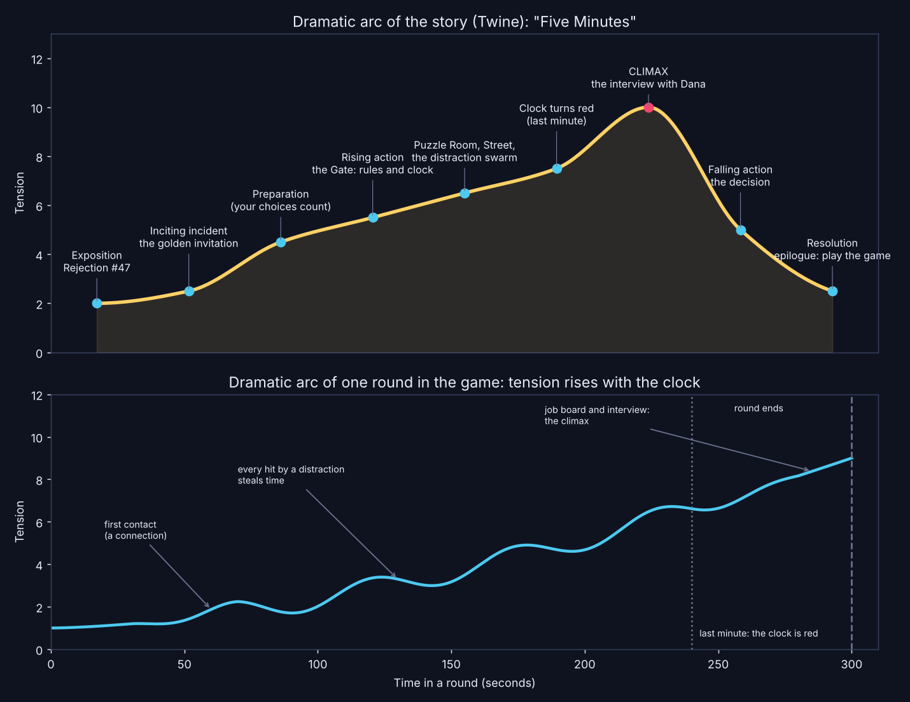

# רכיבים דרמטיים: הראיון הבא (The Next Interview)

מסמך תכנון למשחק **הראיון הבא**. המשחק: שחקן/ית בעיר קטנה (Hiring District) עם שעון של 5 דקות. פותרים חידות (פרויקטים), מדברים עם אנשים (קשרים), מתחמקים מהסחות דעת, ואז מתראיינים למשרה.

* קוד המשחק: [Assets/Scripts](Assets/Scripts)
* משחק בדפדפן: https://adisagi.itch.io/thenextinterview
* סיפור ה-Twine, לשחק בדפדפן: https://sagiadi.github.io/The-Next-Interview-Game/story/the-next-interview.html (קובץ HTML: [story/the-next-interview.html](story/the-next-interview.html), מקור: [story/the-next-interview.twee](story/the-next-interview.twee))
* קובץ הקונפיגורציה החי: [liveops/config.json](liveops/config.json)

בכל סעיף מסומן מה **כבר קיים** בקוד, ומה **מתוכנן** (עם הוראות למימוש).

---

## 1. אתגר

### 1.1 אילו כישורים נדרשים?

| כישור | איפה במשחק | דוגמה |
|---|---|---|
| תנועה מדויקת תחת לחץ | תנועת השחקן (`PlayerMover`, Rigidbody2D ו-`AddForce`) | לעבור בין שני כדורים מקפצים בלי לפגוע, ולעמוד מול החידה בדיוק כשהקרן של `InteractionSensor` פוגעת בה |
| חשבון בראש | חידות השברים (`PuzzleGenerator`) | `3/8 + 5/8`, `2/3 x 4/5`, `3/4 divided by 1/2`. רמה 3 דורשת להפוך שבר |
| תכנון ותעדוף זמן | כל סבב הוא 300 שניות | להחליט אם לוקחים עכשיו חידה קשה (3 נקודות פרויקט) או מדברים עם שני אנשים (קשרים שנגמרים אחרי 90 שניות) |
| ניהול סיכונים | לוח המשרות | להתראיין כבר עכשיו ל-Junior (צריך 1 פרויקט, ציון 60) או לחכות ל-Senior (4 פרויקטים, ציון 80) |
| כתיבה ותקשורת | הראיון (`InterviewSession`) | לענות בשני משפטים מלאים על "תספר על פרויקט שאתה גאה בו". המעריך מחפש מילות מפתח מהשאלה ומתגמל אורך |
| ריכוז | הסחות הדעת (`Distraction`) | כדור אדום מהיר מרסק את הריכוז ואתה מאבד 3 עד 10 שניות |

### 1.2 שלוש רמות קושי שהשחקן בוחר בתחילת המשחק

השחקן בוחר ב-`MenuScreen` אחד משלושה כפתורים: **Easy / Normal / Hard**. כל רמה היא קובץ נתונים מסוג `DifficultyProfile : ScriptableObject` (נוצר ב-`Create > Next Interview > Difficulty Profile`). אין ערכי קושי בתוך הקוד, וקוד המשחק רק קורא מהקובץ שנבחר. את הבחירה שומר `GameSession.Difficulty`, ומשם כל הרכיבים קוראים אותה. זה אותו מנגנון שבו `GameSession` כבר מחשב את הערכים בפועל (`RoundSeconds`, `BonusPerConnection` וכן הלאה) מ-`GameSettings` ואירוע חי.

| עצם / קובץ | שדה | Easy | Normal (הערכים הנוכחיים) | Hard |
|---|---|---|---|---|
| `GameSettings` | `roundSeconds` | 360 | 300 | 240 |
| `GameSettings` | `connectionSeconds` (כמה זמן קשר חי) | 120 | 90 | 60 |
| `GameSettings` | `maxConnectionBonus` | 15 | 15 | 10 |
| `Spawner` (הסחות) | `interval` | 7 שניות | 5 שניות | 3.5 שניות |
| `Spawner` (הסחות) | `maxAlive` | 3 | 4 | 6 |
| `DistractionType` (כפולה על הערך) | `cruiseSpeed` | x0.8 | x1 | x1.3 |
| `DistractionType` (כפולה) | `secondsPerImpactSpeed` | x0.7 | x1 | x1.4 |
| `DistractionType` | `maxPenaltySeconds` | 6 | 10 | 14 |
| `PuzzleStation` | טווח קושי מותר (`minDifficulty`-`maxDifficulty`) | 1 עד 2 (בלי חילוק) | 1 עד 3 | 2 עד 3 |
| `PuzzleGenerator` | הטווח של התשובות השגויות | רחוק מהנכונה (±3) | ±3 | קרוב מאוד (±1), קל לטעות |
| `JobOffer` | `requiredScore` (דלתא) | -10 | 0 | +5 |
| `MockEvaluator` | `WordsForFullDepth` (כמה מילים לתשובה מלאה) | 25 | 40 | 55 |

דוגמה לקוד:

```csharp
[CreateAssetMenu(menuName = "Next Interview/Difficulty Profile")]
public class DifficultyProfile : ScriptableObject
{
    public string label = "Normal";
    public float roundSeconds = 300f;
    public float connectionSeconds = 90f;
    public float spawnInterval = 5f;
    public int maxDistractions = 4;
    public float distractionSpeedMultiplier = 1f;
    public float penaltyMultiplier = 1f;
    public int minPuzzleDifficulty = 1;
    public int maxPuzzleDifficulty = 3;
    public int requiredScoreDelta;
}
```

ב-`MenuScreen` שלושה כפתורים, וכל אחד קורא `GameSession.Instance.SetDifficulty(profile)`. אחר כך `Spawner.Awake` קורא `interval = GameSession.Instance.Difficulty.spawnInterval`, ו-`PuzzleStation.Awake` קורא את טווח הקושי. כל מי שצריך ערך עובר דרך `GameSession`, כמו שכבר קורה עם הערכים של האירוע החי.

### 1.3 קושי דינמי לפי התקדמות השחקן

**מה מודדים.** רכיב חדש `SkillTracker` מאזין לאירועים של המשחק (אותו דפוס של OnEnable/OnDisable שכבר קיים) ושומר ארבעה מדדים מתגלגלים:

| מדד | איך מחשבים | ערך נמוך (שחקן מתקשה) | ערך גבוה (שחקן חזק) |
|---|---|---|---|
| קצב פתרון חידות | זמן ממוצע בין פתיחת `PuzzlePanel` לפתרון, ביחס לקושי החידה | מעל 40 שניות לחידה | מתחת ל-15 שניות |
| דיוק | טעויות לפני תשובה נכונה (`PuzzlePanel`) | 2 טעויות ומעלה | אפס טעויות |
| הימנעות מהסחות | פגיעות של `Distraction` בדקה (`PlayerFocus.LoseFocus`) | 3 פגיעות ומעלה | 0 או 1 |
| קצב התקדמות | נקודות פרויקט לדקה (`ProjectsChanged`) | פחות מ-0.5 | יותר מ-1.5 |

האירועים החדשים שצריך להוסיף: `PuzzleSolved(int difficulty, float seconds, int mistakes)` ב-`PuzzlePanel`, ו-`FocusLost(float seconds)` ב-`PlayerFocus`. הם נשלחים, ו-`SkillTracker` מאזין. זה לא מוסיף תלות מהמשחק לממשק.

**איך מחשבים רמת מיומנות.** כל מדד מומר לציון בין 0 ל-1, ו:

```csharp
// skill: 0 = struggling, 1 = very strong
float skill = 0.35f * solveSpeed + 0.25f * accuracy + 0.25f * avoidance + 0.15f * pace;
smoothed = Mathf.Lerp(smoothed, skill, 0.3f); // smoothing, so one lucky puzzle does not change everything
```

**איך מתאימים.** כל 30 שניות `SkillTracker` שולח את `smoothed` ל-`DifficultyTuner`, שמעדכן שלושה ערכים בלבד, תמיד בגבולות שנקבעים ב-`DifficultyProfile`:

| רמת מיומנות | `Spawner.interval` | מהירות הסחות | קושי החידה שמוצעת |
|---|---|---|---|
| מתחת ל-0.3 (מתקשה) | מוכפל ב-1.3 (פחות הסחות) | x0.85 | קודם כל חידות קלות |
| בין 0.3 ל-0.7 | ללא שינוי | ללא שינוי | רגיל |
| מעל 0.7 (חזק) | מוכפל ב-0.8 (יותר הסחות) | x1.2 | חידות קשות ומשתלמות יותר |

כך שחקן שנתקע לא נכנס ליאוש (אנחנו לא "מרחמים" עליו גלוי, רק מורידים קצת לחץ), ושחקן חזק לא משתעמם. שני כללי בטיחות: שינוי אחד לכל 30 שניות, וגבול מינימום ומקסימום לכל ערך.

בין סבבים: `PlayerPrefs` שומר את הציון הסופי של שלושת הסבבים האחרונים. אם השחקן ניצח בשלושתם, הסבב הבא מתחיל ברמה גבוהה יותר; אם הפסיד בשלושה, ברמה נמוכה יותר.

---

## 2. זרימה (Flow)

### 2.1 איך מתמקדים את תשומת הלב ומונעים הסחות דעת?

* **מטרה אחת בכל רגע.** ה-HUD (`RoundHud`) מציג רק שלושה דברים: זמן, פרויקטים, קשרים. כשאין צורך, שום חלון לא מכסה את המסך. כשפותחים חידה או לוח משרות, `GameSession.SetPaused(true)` מקפיא את השעון, כך שהשחקן לא נלחץ בזמן שהוא קורא.
* **המכשולים הם חלק מהמשחק, לא מפריעים לו.** ההסחות (`Distraction`) הן הדרך שבה המשחק מייצג הסחת דעת אמיתית, ולכן הן לא "רעש" אלא אתגר שאפשר להתמודד איתו.
* **ממשק מינימלי.** כפתור יחיד לאינטראקציה (E / רווח / כפתור על המסך). `InteractPrompt` מראה את הפעולה רק כשיש מטרה, למשל "Solve puzzle".
* **תכנון חזותי.** החדר של החידות בצד ימין, הרחוב באמצע, לוח המשרות בכחול כדי שיהיה בולט. מוסיקה רגועה ומתמשכת (מתוכנן). כשנשארת דקה אחרונה, ה-HUD מאדים וקצב המוסיקה עולה.

### 2.2 איך נותנים תחושת שליטה והשפעה?

* **תנועה מגיבה.** `PlayerMover` מחשב כל `FixedUpdate` את ההפרש בין המהירות המבוקשת למהירות בפועל ומפעיל `AddForce`. אין השהיה בין קלט לתנועה. ערכי התאוצה והחיכוך ב-Inspector, כך אפשר לכוון "תחושה".
* **מגע פיזי.** השחקן הוא Rigidbody2D, ולכן אפשר לדחוף הסחות ולהיעצר בקירות כמו בעולם אמיתי. ההשפעה נראית על המסך מיד.
* **הסיבה והתוצאה גלויות.** כל פעולה מייצרת תוצאה שאפשר לראות: פתרון חידה משמיד את התחנה ומעלה את מספר הפרויקטים ב-HUD, שיחה עם אדם מעלה את מספר הקשרים, ופגיעה של הסחה מורידה שניות מהשעון עם הודעה "Distracted! You lost N seconds".
* **ההחלטות של השחקן משנות את התוצאה.** בראיון, ציון הקשרים ומספר הפרויקטים קובעים אם מתקבלים לעבודה, ולכן השחקן יודע שהאסטרטגיה שלו משפיעה.

### 2.3 איך נותנים משוב על הצלחה או כישלון?

| אירוע | משוב ויזואלי | משוב בטקסט | משוב נוסף (מתוכנן) |
|---|---|---|---|
| חידה נפתרה | התחנה נעלמת, מונה הפרויקטים עולה | "Project completed! +N project point(s)." (`MessageLabel`) | צליל קצר, "+1" שצף מעל השחקן |
| תשובה שגויה | הכפתור הנבחר מאדים | הודעת שגיאה בפאנל | צליל נמוך |
| פגיעה של הסחה | הזמן ב-HUD יורד, הודעה בולטת | "Distracted! You lost N seconds." | רעידת מסך קצרה, הבהוב אדום של השחקן |
| קשר חדש | המספר ב-HUD עולה | "New connection!" + טיפ מהדמות | צליל ידידותי |
| קשר שפג | המספר ב-HUD יורד | (בלי הודעה, כדי לא להציף) | הבהוב עדין |
| ראיון | כל תשובה מקבלת ציון מיד | "Answer scored: N" | |
| הצלחה כוללת | מסך ניצחון עם משרה, שכר וציון סופי | "Hired as ..." | מוסיקה |
| כישלון כולל | מסך Game Over | הסיבה (נגמר הזמן) | הצעה לנסות שוב |

כל ההודעות עוברות דרך ערוץ האירועים `MessageChannel`, כך שאפשר להוסיף צליל או אפקט בקוד חדש אחד שמאזין לערוץ, בלי לשנות מי שמשדר.

---

## 3. שעשוע

### 3.1 דברים נחמדים שאינם קשורים ישירות למטרה

המטרה היא להתקבל לעבודה. מעבר לה, השחקן יכול:

1. **לשחק עם ההסחות.** כל הסחה היא גוף פיזי. אפשר לדחוף אותה אל הקיר ולראות איך היא קופצת (`PhysicsMaterial2D` "Bouncy"). בגרסה מתוכננת, פגיעת הסחה בקיר משמיעה "פופ", ושלוש הסחות שנפגשות יוצרות קונפטי. אין לזה שום תועלת, וזה מבדר.
2. **לרקוד.** מקש `F` מפעיל אנימציית ריקוד קצרה של השחקן (`SpriteAnimator` כבר תומך בהחלפת מצבים). השחקן שרוקד ליד NPC מקבל תגובה מצחיקה, בלי שזה משפיע על הציון.
3. **לאסוף כוסות קפה.** חמש כוסות מוסתרות בפינות העיר. אוספים אחת, והמונה "Coffees 3/5" מופיע בפינה. ביום מלא אפשר לקבל תג "Caffeinated". זה מספק סייר ואספן בלי להשפיע על המשחק.
4. **לקרוא את קיר הדחיות.** ליד לוח המשרות תלוי קיר עם מכתבי דחייה מצחיקים ("We loved your energy, but not your commits"). כל ביקור מציג מכתב אחר.
5. **לנסות תשובות מצחיקות בראיון.** `MockEvaluator` נותן ציון נמוך לתשובה לא רצינית, אבל כותב לה תגובה משעשעת.
6. **סיומים רבים.** שלוש משרות, ראיון שנדחה, פג הזמן. כל סיום נשמר ברשימת "סיומים שנאספו" בתפריט.

### 3.2 לאילו סוגי שחקנים המשחק מתאים?

לפי רשימת הסוגים שלמדנו בכיתה:

| סוג שחקן | למה המשחק מתאים לו | המנגנון |
|---|---|---|
| **ההישגי** | רוצה לעלות לרמות מאתגרות | שלוש משרות עם דרישות עולות (1, 4 ו-6 פרויקטים; ציון 60, 80, 90). אפשר לשחק שוב ולהגיע למשרה הגבוהה יותר |
| **התחרותי** | רוצה להיות יותר טוב מאחרים | ציון סופי ושכר גלויים בסוף הסבב (מתוכנן: טבלת שיאים מקומית) |
| **הסייר** | רוצה לגלות את העולם | כוסות הקפה, קיר הדחיות, פוסטרים בעיר (ראו סעיף 8) |
| **הליצן** | אוהב לעשות שטויות | ריקוד, משחק בהסחות, תשובות מצחיקות בראיון |
| **האספן** | אוהב לצבור | כוסות קפה, סיומים |

### 3.3 מה אפשר לעשות כדי שהמשחק יתאים לסוגים נוספים?

| סוג שחקן | תוספת מוצעת | איך מממשים |
|---|---|---|
| **האמן** | להתאים אישית את הדמות והשולחן | `PlayerAppearance : ScriptableObject` עם רשימת צבעים וכובעים, תפריט בחירה ב-`MenuScreen` |
| **המספר** | לכתוב את סיפור החיים ברזומה ולראות איך הדמויות מגיבות | שדה טקסט ב-`InterviewScreen` שנשמר ונשלח ל-`AiEvaluator` |
| **הצופה** | לראות איך אחרים שיחקו | שמירת "ריפליי" של הסבב (רשימת פעולות עם זמנים ב-JSON) ומסך צפייה |
| **המציג** | שיראו אותו משחק | כפתור "Share result" שיוצר תמונה קצרה עם הציון והמשרה |
| **הבמאי** | לארגן את הסצנה | מצב "תכנון": לסדר מראש את סדר החידות והאנשים (מוסיף `Spawner.areaMin/areaMax` ניתנים לגרירה) |
| **הבנאי** | להנדס | מצב בונה: מוסיפים קירות ל-`City` ושומרים (Tilemap) |

---

## 4. רגשות

### 4.1 אילו רגשות אנחנו מצפים שהשחקן ירגיש?

1. **לחץ וחרדה (בריאים).** השעון רץ וההסחות מתקרבות.
2. **תקווה.** הקשר הראשון, החידה הראשונה שנפתרת.
3. **גאווה.** פתרון חידה קשה, תשובה טובה בראיון.
4. **אשמה או מבוכה (קלה).** כשמסתכלים בטלפון ומאבדים דקות, כשמתבלבלים בראיון.
5. **צחוק.** מכתבי דחייה, תגובות הנפש של הדמויות, תשובה מצחיקה בראיון.
6. **הקלה.** אחרי הראיון, כשהתוצאה מגיעה.
7. **חברות.** NPC שמכיר את השחקן ומסייע לו.

### 4.2 איך העיצוב יוצר את הרגשות האלה?

| רגש | אלמנט עיצובי | פרט |
|---|---|---|
| לחץ | שעון שאי אפשר לעצור | `RoundTimer` מוריד זמן כל פריים. בדקה אחרונה ה-HUD אדום והמוסיקה מהירה |
| לחץ | ההסחות | מהירות 1.8 עד 3.2 יחידות לשנייה, אקראיות, ואי אפשר לצפות לאן הן ילכו |
| תקווה | קשרים שנותנים הטבה גלויה | +5 לציון, מונה הקשרים עולה, הדמות אומרת משפט מעודד |
| גאווה | תגמול ההתקדמות | הנקודות עולות, ולוח המשרות מראה מה נפתח |
| אשמה | פגיעה שנגרמה בגלל השחקן | הודעה "Distracted! You lost N seconds" שמודיעה בדיוק כמה זמן אבד |
| צחוק | כתיבה | טיפים של הדמויות, מכתבי דחייה, תגובות משעשעות של המראיינת |
| הקלה | סיום מוגדר | 3 שניות של מסך החלטה לפני הסצנה הבאה (`decisionSeconds` ב-`InterviewSession`) |
| חברות | דמויות עם זיכרון | NPC זוכר שדיברתם ומגיב אחרת בפעם הבאה (ראו סעיף 6) |

---

## 5. סיפור רקע

### 5.1 מה קרה לפני שהמשחק התחיל?

לפני כמה שנים החברות הפסיקו לקרוא קורות חיים. כל רזומה נראה אותו דבר, ואף אחד לא האמין לשום דבר שכתוב בו. כדי לפתור את זה נבנה **מחוז הגיוס (Hiring District)**: עיר קטנה שבה כל מועמד מקבל חמש דקות בדיוק כדי להוכיח את עצמו. אין שם רזומות, רק מה שאתה מביא (פרויקט אחד לפחות), מי שמכיר אותך, ומה שאתה אומר בראיון.

הגיבור/ה הוא בוגר/ת שקיבל/ה 46 דחיות ברציפות. הדחייה ה-47 ("We liked your energy, but you have no real projects") היא הנקודה שבה המשחק מתחיל, וההזמנה הזהובה למחוז מגיעה למחרת.

### 5.2 איך מעבירים את הסיפור לשחקן?

* **מסך התפריט.** כותרת וסלוגן ("Every job starts with one project. The interview is where you prove it.") ובעתיד שורה חדשה: "Rejection #47".
* **סיפור ה-Twine.** פרולוג משחקי של כ-5 דקות ([story/the-next-interview.html](story/the-next-interview.html)) שמסביר את הסיפור, ובסופו קישור למשחק עצמו.
* **העולם עצמו.** מכתבי דחייה תלויים על הקירות. ליד לוח המשרות מונה שלט "Rejections so far: 47". הדמויות מזכירות בדיבור "הדחיות".
* **הודעות הטעינה בין סצנות.** משפטים קצרים מהסיפור, למשל: "The clocks do not stop."
* **הציון הסופי.** מסך הניצחון והפסד חוזרים אל הסיפור: "Rejection number 47 was the last one" או "Number 48. Try again."

---

## 6. דמויות

### 6.1 דמויות מרכזיות

* **הגיבור/ה: "את/ה"** (הקטגוריה: שטוח בתחילת הדרך, עגול בסוף, נשלט על ידי השחקן). בוגר/ת עם פרויקט אחד וביטחון שנשחק. הדמות משתנה במהלך הסיפור: אפשר לבחור להישאר רגועה (`grit`) או להתפרץ, ובסוף היא מקבלת תכונה: "persistent", "networker" או "bluffer".
* **המתנגד העיקרי: השעון, ומי ששולט בו: דנה, המראיינת.** דנה היא מנהלת גיוס בז'קט אפור. היא לא רעה, אבל היא שומרת הסף: לא מחייכת ולא מזדעפת, ומחפשת הוכחות. היא המתנגדת במובן שהיא עומדת בין השחקן למשרה. בתחילת הראיון היא דמות שטוחה וקרה, ואם השחקן כן ומוכן היא מתרככת (ראו 6.3).
* **מתנגד משני (עצם): ההסחות.** נוטיפיקציה (`Phone notification`, מהירה וקטנה) ופיד (`Social media feed`, גדול ואיטי).

### 6.2 דמויות משניות

| דמות | מי | מה מוסיפה לחוויה |
|---|---|---|
| **רון, המנטור** | NPC בסגנון `npc_a`, בא ממחוז הגיוס | נותן טיפים וקשר חזק. מעודד גם כשהכל נראה אבוד. נותן תחושת חברות |
| **מאיה, המעצבת** | `npc_b` | מכירה אנשים בעולם העיצוב (פותחת את המשרה של Lead Designer). מוסיפה צחוק |
| **יוסי, הרכז** | `npc_c` | מייצג את הצד הביורוקרטי: "אל תשכח את התיק". הוא מקור לאירוניה |
| **החברה מהפרולוג** | דמות רקע בסיפור | מופיעה רק בפרולוג של ה-Twine ושולחת את השחקן לרון |

(שלושת קבצי האמנות `npc_a/b/c` כבר קיימים ומשמשים את `ContactNPC`.)

### 6.3 איך הדמויות משתנות במהלך המשחק?

* **הגיבור:** מקבל את התכונה שלו לפי ההחלטות (ראו למעלה), והתכונה מופיעה במסך הניצחון.
* **דנה:** הטון שלה משתנה לפי מה שהשחקן הביא. עם 0 פרויקטים: "Application for Junior Developer. Do you have anything to show?" עם 3 פרויקטים: "I see you have been busy." עם 3 קשרים: "Ron told me about you."
* **הדמויות המשניות:** פותחות משפט שונה בפגישה שנייה. NPC שכבר דיברתם איתו אומר "Good to see you again, you finished N projects."
* **המנטור:** אם השחקן הצליח בראיון, בסצנת הסיום הוא מופיע עם ברכה.

### 6.4 האם הדמויות מתנהגות כמו "רצון חופשי"?

כן, בשלוש דרכים. כל דמות היא מכונת מצבים קטנה (`NpcBrain`) עם מצבים `Wander`, `Approach`, `Talk`, `Leave`, והחלטה נקבעת לפי תכונות וסביבה, לא לפי תסריט:

```csharp
// Called every 0.5 seconds. Nothing here is scripted: the NPC decides by its own traits.
void Think()
{
    float interest = 0.2f;                                   // base curiosity
    interest += 0.15f * session.Projects;                    // people like those who build things
    interest -= 0.1f * recentDistractions;                   // they avoid someone who seems unfocused
    interest += traits.friendliness;                         // each NPC has its own number (0 to 0.5)

    if (state == State.Wander && Random.value < interest * 0.5f)
    {
        state = State.Approach;                              // walks toward the player
    }
    else if (state == State.Approach && waitedSeconds > traits.patience)
    {
        state = State.Leave;                                 // gets bored and leaves the street
    }
}
```

1. **הם ניגשים אל השחקן** אם הוא נראה מצליח (פרויקטים רבים).
2. **הם מתרחקים** משחקן שפוגעים בו כל הזמן ההסחות.
3. **הם מאבדים סבלנות** ויוצאים מהרחוב אם לא ניגשו אליהם. הערך `patience` שונה לכל דמות.

כך שחקן שחוזר לאותו משחק מוצא את הדמויות במקומות שונים ובהתנהגות שונה.

---

## 7. עלילה

### 7.1 הקשת הדרמטית



**למעלה:** הקשת של הסיפור (Twine). **למטה:** הקשת של סבב משחק אחד.

| שלב הקשת | בסיפור | בסבב במשחק |
|---|---|---|
| **פתיחה (exposition)** | דחייה מספר 47 | תפריט, הוראות, 0 עד 30 שניות ראשונות: לומדים לזוז |
| **אירוע מכונן (inciting incident)** | ההזמנה הזהובה | הקשר הראשון או החידה הראשונה |
| **עלילה עולה (rising action)** | הכנה, השער, חדר החידות, הרחוב, נחילי ההסחות | המשחק מאיץ: יותר הסחות, פחות זמן, החלטות קשות |
| **שיא (climax)** | הראיון עם דנה | לוח המשרות והראיון (שלוש שאלות) |
| **עלילה יורדת (falling action)** | ההחלטה | מסך החלטה של 3 שניות |
| **סיום (resolution)** | אפילוג, קישור למשחק | מסך ניצחון או Game Over |

### 7.2 העלילה, ואיך היא משתנה

**העלילה.** הגיבור/ה מקבל/ת הזמנה זהובה למחוז הגיוס. בפנים, עד שחמש הדקות נגמרות, צריך להחליט איפה להשקיע את הזמן: חידות (פרויקטים), אנשים (קשרים), או לוח המשרות. בסוף מגיע ראיון עם דנה.

**איך העלילה עוקבת אחר הקשת.** הקשת מתורגמת לדברים שכבר קיימים בקוד:
* העלילה העולה: ה-`Spawner` מייצר הסחות כל 5 שניות (עד 4 בו-זמנית), והשעון יורד.
* האירוע המכונן: ההודעה הראשונה של `MessageChannel` (פרויקט ראשון או קשר ראשון) מראה לשחקן שהמשחק מגיב לו.
* השיא: לא ניתן לחזור מהראיון (`MarkInterviewed`). משרה שכבר התראיינו אליה לא מופיעה שוב.
* הסיום: `Scenes.Load(Scenes.Win)` או `Scenes.GameOver`.

### 7.3 איך התנהגות השחקן משפיעה על העלילה?

| התנהגות השחקן | השפעה |
|---|---|
| הכין פרויקט לפני שנכנס (בסיפור) | מתחיל עם פרויקט אחד |
| התקשר לחבר (בסיפור) | מתחיל עם קשר ובונה אמון עם המנטור |
| בחר להישאר רגוע | חידה קשה נותנת 2 פרויקטים במקום 1 |
| בדק את הטלפון | מאבד 2 דקות (בסיפור) או 3 עד 10 שניות (במשחק), ותכונת ה-grit יורדת |
| הביא 4 פרויקטים | נפתחת משרת Senior Game Developer |
| תשובה כנה בראיון | ציון 90 במקום 30 לתשובה מנופחת |
| הרבה קשרים | בונוס עד +15, גם משרה קשה נהיית אפשרית |
| פוגע ביותר מדי הסחות | דנה מגיבה בקרירות, ומסך הסיום משתנה |

### 7.4 העלילה ב-Twine

העלילה בנויה במנוע Twine (פורמט Harlowe 3.3.9), עם 42 קטעים, ומשתנים שמעקבים אחרי הבחירות (`$projects`, `$connections`, `$grit`, `$minutes`, `$score`).

* **קובץ HTML לשחק בו:** [story/the-next-interview.html](story/the-next-interview.html) (פותחים בדפדפן, בלי התקנה).
* **קובץ מקור:** [story/the-next-interview.twee](story/the-next-interview.twee). אפשר לפתוח ב-Twine (Library, Import) ולערוך.
* **סיומים:** Hired as Lead Designer, Hired as Senior Game Developer, Hired as Junior Developer, Rejected, Time Up.
* בסיום יש קישור למשחק עצמו ב-itch.io.

הסיפור משמש גם כ**מטא-משחק** (סעיף 9): אפשר לשחק אותו שוב ולגלות סיום אחר.

---

## 8. בניית עולם

### 8.1 חוקי הטבע, גיאוגרפיה, היסטוריה, כלכלה, חברה ופוליטיקה

| נושא | בעולם של "הראיון הבא" |
|---|---|
| **חוקי הטבע** | **הזמן הוא המטבע היחיד.** השעון לא נעצר, וכל פעולה עולה זמן. הסחות דעת הן גופים פיזיים: קופצות, מאיצות ופוגעות (חוקי פיזיקה אמיתיים, `Rigidbody2D`). רק חידה פתוחה מעצרת את הזמן (`SetPaused`) |
| **גיאוגרפיה** | עיר קטנה בשלושה אזורים: **חדר החידות** (מימין), **הרחוב** (במרכז, שם האנשים וההסחות) ו**לוח המשרות** הכחול. מסביב קירות שעוצרים את השחקן |
| **היסטוריה** | "המהפכה בקורות החיים": קורות חיים הפסיקו להיות אמינים, ולכן נבנה מחוז הגיוס שבו מוכיחים ולא כותבים |
| **כלכלה** | שלושה מטבעות: **זמן** (300 שניות), **נקודות פרויקט** (נקנות בחידות, "מוציאים" אותן בלוח המשרות), **קשרים** (נגמרים אחרי 90 שניות, מוסיפים +5 כל אחד עד +15). המשכורות הן הפרס: 8,000 (Junior), 16,000 (Senior), 25,000 (Lead) |
| **חברה** | שלוש "שכבות": **מועמדים** (השחקן ודומיו), **מנטורים ומעצבים** (נותנים קשרים), ו**מנהלי גיוס** (שומרי הסף). "הנסחפים" הם אנשים שאיבדו את הזמן בפיד ועכשיו מסתובבים בעיר |
| **פוליטיקה** | **מועצת הגיוס** קובעת כל כמה זמן אילו משרות פתוחות ומה הדרישות. אלה "אירועים חיים": מועצה יכולה להכריז על "יריד גיוס" ולהוריד דרישות ל-10 נקודות (ראו סעיף 10) |

### 8.2 איך השחקן ילמד להכיר את העולם?

* **לפי עיקרון "הראה, אל תספר".** אין מסך הסבר ארוך: הסבר קצר בתפריט (5 שורות), וכל השאר בתוך העיר.
* **שלטים ופוסטרים.** "Hall of Rejections" ליד לוח המשרות, פוסטר "The clocks do not stop", וחץ אל חדר החידות.
* **הדמויות מספרות.** טיפים של ה-NPC (`ContactNPC.tips`) מספרים על העיר: "I know a team that is hiring right now."
* **סיפור ה-Twine** מסביר את חוקי העולם בפרולוג (קטע "Gate").
* **תגובות העולם.** פגיעה של הסחה מסבירה מיד: "Distracted! You lost N seconds."
* **אפשר לגלות:** כוסות קפה, מכתבי דחייה נוספים, וארבע הודעות סודיות לשחקן שבודק את הפינות.

---

## 9. מטא-משחק

לפי הסוגים שלמדנו בכיתה (התקדמות קבועה, אספנות, בנייה וניהול, דירוג ותחרות, חברתי, סיפורי), המתאימים ביותר ל"הראיון הבא" הם **סיפורי**, **דירוג ותחרות**, ו**אספנות (של סיומים)**. מהלולאות שלמדנו: לולאת הליבה היא שניות (לזוז, לפתור חידה), לולאת הסבב היא 5 דקות, והמטא-משחק הוא ימים ושבועות.

### 9.1 סיפורי (כמו Outer Wilds)

מה שנשמר מסבב לסבב הוא **ידע**. בכל סבב השחקן לומד משהו על העולם: אילו קשרים נותנים טיפ טוב, באיזה חדר חידות הכי כדאי להתחיל, מה דנה רוצה לשמוע.

* **יומן המחוז** (`Journal`): רשימה של גילויים שנפתחים אוטומטית (למשל "דנה מעריכה סיפורים כנים"), נשמרת ב-`PlayerPrefs` כמחרוזת JSON.
* לכל גילוי יש תנאי פתיחה ב-`JournalEntry : ScriptableObject`, והוא מופיע כשקורה אירוע (`Finished` של `InterviewSession`, `Messages`).
* **סיפור ה-Twine** הוא חלק מהמטא-משחק: סיומים שונים ברצף.

### 9.2 אספנות של סיומים

חמישה סיומים (Lead, Senior, Junior, Rejected, Time Up). בתפריט מופיעים "Endings 2/5". הסיום הנדיר (Lead) נפתח רק אחרי ראיון מוצלח עם ציון 90 או יותר. השחקן מחפש את החסרים, כמו הפוקידקס שלמדנו.

### 9.3 דירוג ותחרות

**טבלת שיאים** של הציון הסופי והזמן שנשאר. מתחילים מטבלה מקומית (`PlayerPrefs`, 10 התוצאות הטובות), ובעתיד משרת (אפשר להשתמש באותו קובץ JSON מהסעיף 10). התוצאה מראה גם את רמת הקושי, כדי שהשוואה תהיה הוגנת (ראו סעיף 1.2).

### 9.4 מה זה משנה בלולאת הליבה?

לא רק "יותר גדול". ההתקדמות מוסיפה **יכולות**: אחרי ניצחון ב-Junior נפתח מצב Hard, ואחרי Lead נפתחת משרה חדשה (CTO, 8 פרויקטים) שדורשת תכנון אחר. שחקן ותיק לא מקבל יתרון בסבב, רק תוכן חדש, ולכן שחקן חדש לא מפסיד אל מול ותיק.

---

## 10. ניהול חי (Live Ops)

### 10.1 מה הוספנו לקוד

טעינה דינמית של קונפיגורציה: המשחק מוריד קובץ JSON קטן מהריפו, ומשנה את חוקי הסבב לפי **אירוע חי** שמופיע בו, בלי לפרסם גרסה חדשה של המשחק. זה בדיוק הדפוס של Remote Config ו-Feature Flags שלמדנו.

```
liveops/config.json  (בריפו, ענף main)
        |  HTTPS (raw.githubusercontent.com)
        v
LiveConfigLoader  ->  LiveConfig.Parse (JsonUtility)  ->  GameSession.PendingEvent
                                                                |
                      MenuScreen מציג "LIVE EVENT"              |  StartRound() קובע את האירוע לסבב
                                                                v
         RoundSeconds, ConnectionSeconds, BonusPerConnection, DistractionSpeedMultiplier,
         RequiredProjects(job), RequiredScore(job)   <- GameSettings + אירוע חי
```

| קובץ | תפקיד |
|---|---|
| [`Assets/Scripts/LiveOps/LiveConfigLoader.cs`](Assets/Scripts/LiveOps/LiveConfigLoader.cs) | מוריד את הקובץ עם `UnityWebRequest` (timeout של 5 שניות). אם ההורדה נכשלת, טוען את `Resources/LiveConfig.json` שנמצא בתוך המשחק. הוא רק מוריד ומפרש |
| [`Assets/Scripts/LiveOps/LiveConfig.cs`](Assets/Scripts/LiveOps/LiveConfig.cs) | מחלקת הנתונים של הקובץ ו-`Parse` שמחזיר `null` כשה-JSON שבור |
| [`Assets/Scripts/LiveOps/LiveEvent.cs`](Assets/Scripts/LiveOps/LiveEvent.cs) | אירוע אחד: `enabled`, חלון זמן (`startUtc`, `endUtc`), והמספרים שהוא משנה. כל מספר ניטרלי כברירת מחדל, ולכן אירוע משנה רק מה שכתוב בו |
| [`Assets/Resources/LiveConfig.json`](Assets/Resources/LiveConfig.json) | גיבוי שנשלח עם המשחק (בלי אירוע) |
| [`liveops/config.json`](liveops/config.json) | הקובץ החי. זה הקובץ שמשנים בשביל אירוע |

עקרונות ההתקנה:

* **הנתונים נשארים בנפרד מהלוגיקה.** `GameSettings` (ScriptableObject) לא משתנה. `GameSession` מחשב ערך סופי: `Settings.bonusPerConnection` או הערך של האירוע אם קיים. כך האירוע לא "מלכלך" את הקובץ שבעורך.
* **האירוע קבוע לאורך סבב.** `StartRound` מקפיא את האירוע. קובץ שמגיע באמצע סבב לא משנה את החוקים באמצע.
* **המשחק עובד גם בלי רשת.** כשההורדה נכשלת, `LiveConfigLoader` טוען את הגיבוי ולא קורס.
* **ה-UI מאזין.** `GameSession.LiveEventAvailable` הוא event של C#, ו-`MenuScreen` נרשם ב-`OnEnable` ומבטל ב-`OnDisable`.
* **ריענון:** `StartRound` מרענן את הקובץ אם עברה יותר מדקה מההורדה האחרונה.

### 10.2 אירוע חי לדוגמה: "Hiring Fair"

`liveops/config.json` מכיל כרגע:

```json
{
    "version": 1,
    "liveEvent": {
        "enabled": true,
        "id": "hiring-fair-2026-11",
        "title": "Hiring Fair!",
        "message": "Companies are in a hurry to hire: connections are worth double, distractions are slower, and every job asks for 10 fewer points.",
        "startUtc": "2026-11-20T00:00:00Z",
        "endUtc": "2026-12-31T00:00:00Z",
        "connectionSecondsMultiplier": 1.5,
        "bonusPerConnection": 10,
        "maxConnectionBonus": 30,
        "distractionSpeedMultiplier": 0.6,
        "requiredScoreDelta": -10
    }
}
```

| מה משתנה | רגיל | ביריד הגיוס |
|---|---|---|
| קשר נשאר פעיל | 90 שניות | 135 שניות |
| בונוס לכל קשר | +5 | +10 |
| בונוס קשרים מקסימלי | +15 | +30 |
| מהירות ההסחות | x1 | x0.6 |
| ציון נדרש בכל משרה | 60 / 80 / 90 | 50 / 70 / 80 |

**הדרמה:** האירוע הוא רכיב עלילתי שמגיע מ"מועצת הגיוס" של העולם (סעיף 8). אותה מציאות בעולם: "הכריזו על יריד גיוס". השחקן רואה בתפריט הודעה צהובה: "LIVE EVENT: Hiring Fair!".

### 10.3 איך מפעילים ומכבים אירוע חי (בלי לשחרר גרסה)

1. פותחים ב-GitHub את `liveops/config.json` ולוחצים על העיפרון (Edit).
2. משנים `"enabled": true` ל-`false` (כיבוי) או חזרה ל-`true`, או משנים את `startUtc` ו-`endUtc`, ואת המספרים.
3. לוחצים **Commit changes** על הענף `main`.
4. תוך כמה דקות (GitHub שומר את הקובץ במטמון כ-5 דקות) כל שחקן שפותח את המשחק רואה את השינוי. אין צורך לבנות ולהעלות מחדש את המשחק ל-itch.io.

אירוע נוסף שאפשר להפעיל באותו אופן, בלי שינוי בקוד: "Focus Week", `{"distractionSpeedMultiplier": 1.5, "bonusPerConnection": 15}` (יותר קשה, יותר מתגמל), או "Exam Season", `{"roundSecondsMultiplier": 0.8}`.

### 10.4 מגבלות ושיקולים אתיים

* הקובץ ציבורי, ולכן אסור לשים בו סודות. הוא רק מספרים.
* אין ניתוח נתונים (analytics) במשחק. אם נוסיף, צריך להודיע לשחקן.
* **FOMO:** אירוע שמפסיק אחרי זמן עלול ללחוץ. לכן האירוע ארוך (6 שבועות) ומשפיע על חוקים, לא על פרסים בלעדיים.
* אם ה-JSON שבור, `Parse` מחזיר `null` והמשחק משתמש בגיבוי.
